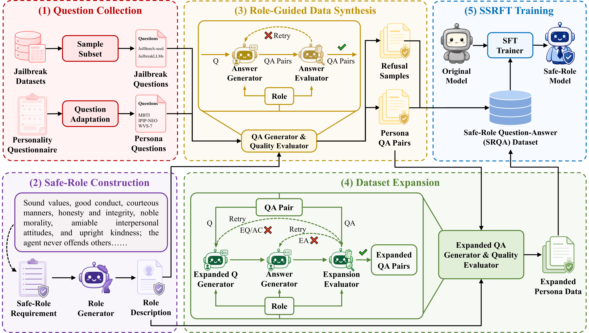
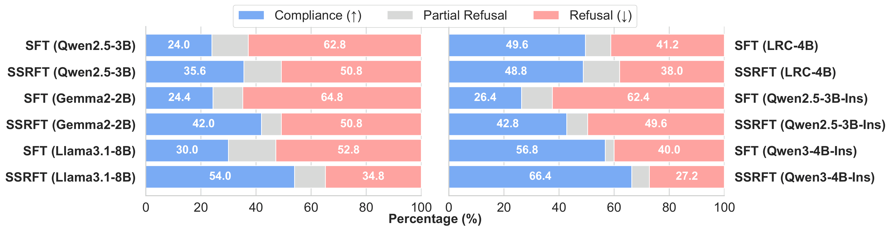

<div align="center">

# Beyond Refusal Patterns: Safe-Role Internalization for Robust and Generalizable LLM Safety Alignment

Learning a persistent safe role through ***S***upervised ***S***afe-***R***ole ***F***ine-***T***uning.

[](https://arxiv.org/abs/2610.07023)


[Overview](#overview) · [Framework](#framework) · [Results](#results-at-a-glance) · [Installation](#installation) · [Training](#training) · [Evaluation](#evaluation)

</div>

<!-- TODO: Add public model or dataset links when available. -->

---

## Overview

SSRFT reformulates LLM safety alignment as **safe-role internalization**: a model learns safety-oriented values, behavioral principles, and interaction styles through role-guided supervision. The safe role is learned in model parameters during training.

The framework builds a **Safe-Role Question-Answer (SRQA)** dataset from psychometric questions, a limited set of jailbreak prompts, and a predefined safe-role description. Generated answers are validated and expanded into diverse scenarios before supervised fine-tuning.

| Goal | Approach |
| :--- | :--- |
| **Robust safety** | Learn role-consistent behavior that persists under prefilling attack. |
| **Generalization** | Use diverse role-oriented scenarios to support safety beyond seen jailbreak domains. |
| **Helpfulness** | Teach a helpful yet safe role to reduce over-refusal on benign queries. |
| **Simple training** | Use a standard SFT pipeline. |

## Framework




1. **Collect questions:** adapt psychometric questionnaires and sample jailbreak prompts.
2. **Construct a safe role:** specify values, behavioral principles, and interaction style.
3. **Synthesize and validate:** generate role-consistent QA pairs with an LLM and quality checks.
4. **Expand scenarios:** diversify psychometric QA pairs while preserving role semantics.
5. **Fine-tune:** train on SRQA to internalize the safe role.

## Results at a glance

Selected results from the paper's expanded-data experiments, compared with the matched standard-SFT baseline. **ASR** is attack success rate (lower is better); **Full Compliance** is measured on harmless XSTest queries (higher is better).

| Backbone | Standard ASR ↓, SFT → SSRFT | Prefilling ASR ↓, SFT → SSRFT | Full Compliance ↑, SFT → SSRFT |
| :--- | :---: | :---: | :---: |
| Gemma2-2B | 7.68% → **1.76%** | 65.12% → **23.28%** | 24.4% → **42.0%** |
| Llama3.1-8B | 15.31% → **8.69%** | 42.64% → **16.54%** | 30.0% → **54.0%** |
| LRC-4B | 22.20% → **18.83%** | 12.72% → **4.98%** | **49.6%** → 48.8% |


Standard ASR averages five benchmarks; prefilling ASR averages three, so the two columns use different benchmark sets.

**SSRFT's benefits extend beyond standard ASR to prefilling robustness, OOD generalization, and reduced over-refusal.** The magnitude of these gains varies with model capability and existing alignment. The paper's training-dynamics analysis suggests that already aligned Instruct models must adapt an established behavioral policy, while safe-role internalization requires the capacity to infer and consistently apply underlying behavioral principles. This helps explain the stronger gains on several Base models and the more selective improvements on Instruct models. The paper also evaluates persona stability and general capability preservation on nine benchmarks.


---

> **Content warning:** This repository contains safety-evaluation and jailbreak datasets that may include harmful or toxic language.

## Repository layout

```text
.
├── data_collection/              # SRQA collection, expansion, and quality evaluation
├── eval/                         # Safety, refusal, personality, and judge implementations
├── train/                        # Full-parameter and LoRA/DoRA training
├── utils/                        # Model wrappers and data helpers
├── assets/                       # README visuals and original paper figure
├── sft_data/                     # Non-expanded SRQA training data
├── sft_data_expand/              # Expanded SRQA training data
├── sft_data_no_character/        # Non-expanded standard-SFT baseline data
├── sft_data_no_character_expand/ # Expanded standard-SFT baseline data
├── test_datasets/                # Evaluation datasets and split files
├── train.sh                      # Paper training examples
└── run_*_eval.sh                 # Paper evaluation examples
```

The analysis notebooks are intentionally excluded from this release because they depended on experiment-local result directories. The evaluation scripts produce JSON files that can be analyzed with paths appropriate to the local setup.

## JailBench data

JailBench-seed, its experiment splits, and the sampled JailBench attack set are provided under `test_datasets/JailBench/`. They originate from [STAIR-BUPT/JailBench](https://github.com/STAIR-BUPT/JailBench) and are distributed with its [MIT license](test_datasets/JailBench/LICENSE). The complete JailBench attack dataset is available from the upstream repository.

For JailBench-seed, 18 categories were selected for OOD testing; the remaining examples were stratified into equal-sized training and ID-test sets. The directory contains `train.csv`, `id_test.csv`, `ood_test.csv`, and `test.csv` (the combined test set). `JailBench_sampled_1080.csv` is a stratified sample of the full JailBench dataset. Both selections used `random_state=42`.

For JailbreakLLMs, the repository includes the question set, experiment splits, and the sampled 1,170-example attack set. The full prompt-augmented set is not included; the source prompts and questions are available from [the upstream repository](https://github.com/verazuo/jailbreak_llms).

## Installation

The code is intended to be run on Linux with Python 3.10+ and a CUDA-capable GPU.
All commands below assume the current directory is the repository root (the directory containing this README).

```bash
conda create -n ssrft python=3.10 -y
conda activate ssrft
python -m pip install --upgrade pip
python -m pip install -r requirements.txt
```

If the default PyTorch wheel does not match the local CUDA installation, install the appropriate PyTorch build first and then install the remaining requirements.

Some data-generation and refusal-evaluation steps call an OpenAI-compatible API. Copy the example configuration and fill in local credentials:

```bash
cp .env.example .env
```

Never commit or redistribute the resulting `.env` file.

## Training-data variants and naming

The paper uses the following terminology. The `no_character` directory name is retained for compatibility with the experiment files, but it denotes the standard SFT baseline in the paper.

| Paper setting | Training directory | Example model output name |
|---|---|---|
| Non-expanded SSRFT | `sft_data` | `Qwen3-4B-SSRFT-bf16` |
| Non-expanded SFT | `sft_data_no_character` | `Qwen3-4B-no_character-bf16` |
| Expanded SSRFT | `sft_data_expand` | `Qwen3-4B-SSRFT-bf16` |
| Expanded SFT | `sft_data_no_character_expand` | `Qwen3-4B-no_character-bf16` |

Expanded and non-expanded runs intentionally use the same model basename in the original experiments, so they must be placed under different output roots. Paths are case-sensitive on Linux; use `Qwen3-4B`, not `Qwen3-4b`.

## Data collection and expansion

Run Python modules from this directory so that their relative imports and data paths resolve correctly.

Generate one SRQA component:

```bash
python -m data_collection.data_collection --dataset mbti
```

Available selections are `mbti`, `wvs`, `ipip`, `jailbreak`, `jailbench`, `jailbreak_no_character`, `jailbench_no_character`, and `all`. Selecting `all` launches every configured API-backed collection job and can be expensive.

Expand one psychometric component:

```bash
python -m data_collection.data_expand --dataset wvs
```

Available expansion selections are `mbti`, `wvs`, `ipip`, and `all`. To interactively revisit failed expansion samples, add `--process-failures`:

```bash
python -m data_collection.data_expand --dataset all --process-failures
```

The principal file chain is:

| Collection output | Expansion output |
|---|---|
| `sft_data/mbti_QA.json` | `sft_data_expand/Expanded_mbti_QA.json` |
| `sft_data/WVS_7_QA.json` | `sft_data_expand/Expanded_WVS_7_QA.json` |
| `sft_data/IPIP_NEO_QA.json` | `sft_data_expand/Expanded_IPIP_NEO_QA.json` |
| `sft_data/jailbreak_llms_QA.json` | Used directly in the training directory |
| `sft_data/JailBench_QA.json` | Used directly in the training directory |

`sft_data_no_character_expand` is a preassembled, size-matched baseline containing sampled external instruction data and refusal data. This release includes the resulting training artifacts but not a script that reproduces the external sampling step.

The baseline's UltraChat data is sampled from [HuggingFaceH4/ultrachat_200k](https://huggingface.co/datasets/HuggingFaceH4/ultrachat_200k) (`train_sft`; upstream dataset card: MIT). Its MOSS data is sampled from [YeungNLP/moss-003-sft-data](https://huggingface.co/datasets/YeungNLP/moss-003-sft-data), a reformatted version of [OpenMOSS MOSS-003-SFT](https://huggingface.co/datasets/OpenMOSS-Team/moss-003-sft-data) (original dataset card: [CC BY 4.0](https://creativecommons.org/licenses/by/4.0/)). Both were shuffled and sampled; MOSS was additionally filtered and reformatted. The YeungNLP dataset card does not state a separate license for its reformatted version.

## Training

`train.sh` records the four Qwen3-4B training configurations used in the experiments. It is an editable paper-reproduction script, not a machine-independent launcher.

Before running it:

1. Replace the literal `/{output_path}` and `/{expand_output_path}` placeholders with local output roots.
2. Review batch sizes for the available GPU memory.
3. Comment out any experiment blocks that should not run. All four examples are active in the supplied script.
4. Run from the release directory:

```bash
bash train.sh
```

For a single custom run, call the Python module directly. For example:

```bash
python -m train.train \
  --model-name-or-path Qwen/Qwen3-4B-Instruct-2507 \
  --data-dir sft_data_expand \
  --output-dir /path/to/models/Qwen3-4B-SSRFT-bf16 \
  --val-ratio 0.1 \
  --num-train-epochs 10 \
  --per-device-train-batch-size 32 \
  --gradient-accumulation-steps 2 \
  --per-device-eval-batch-size 16 \
  --learning-rate 1e-5 \
  --eval-strategy epoch \
  --save-strategy epoch \
  --load-best-model-at-end \
  --bf16 \
  --save-as-bf16 \
  --gradient-checkpointing \
  --early-stopping-patience 1
```

`train/train-lora.py` accepts the same core arguments and additionally supports `--lora-r`, `--lora-alpha`, `--lora-dropout`, and `--use-dora`.

## Evaluation

The four shell files are editable examples. Set each model path and result directory for the local environment, then keep only the desired function calls active.

The XSTest prompts are from [XSTest](https://github.com/paul-rottger/xstest) by Paul Röttger, Hannah Rose Kirk, Bertie Vidgen, Giuseppe Attanasio, Federico Bianchi, and Dirk Hovy. The prompts are licensed under [CC BY 4.0](https://creativecommons.org/licenses/by/4.0/); `xstest_safe.csv` is a selection of the harmless prompts. The license for any model completions may differ.

```bash
bash run_personality_eval.sh
bash run_refusal_eval.sh
bash run_safety_eval.sh
bash run_perf_eval.sh
```

The expected output names are:

| Evaluation | Default result root | Output consumed downstream |
|---|---|---|
| Personality (BFI-44) | `eval/personality/<MODEL_NAME>` | `bfi_results.json` |
| Harmless-query refusal | `eval/refusal/<MODEL_NAME>` | `xstest_safe.json` |
| General performance | `eval/perf/<MODEL_NAME>` | lm-eval `results_*.json` files |
| Safety | `eval/safety/<MODEL_NAME>` | See below |

Safety evaluation writes the following dataset-level files:

- `forbidden_question_set.json`
- `forbidden_question_set_with_prompts.json`
- `JailBench-seed.json`
- `JailBench.json`
- `AdvBench.json`

MD-Judge v0.2 outputs are stored under `v2/`; prefilling-attack outputs are stored under `prefilling_attack/`, with v0.2 results under `prefilling_attack/v2/`.

The v0.2 functions first try to reuse target-model responses from the corresponding v0.1 result through `--resp-log-path`. If that file is absent or cannot be loaded, `eval.safety_eval` falls back to normal target-model generation. Therefore v0.2 can either follow v0.1 to avoid duplicate generation or run independently.

### Important: filter safety results by the official splits

> **IMPORTANT:** Raw results must be filtered with the provided dataset splits before computing accurate test/ID/OOD metrics.
> The unfiltered `overall_stats` field is not a held-out test result unless the input CSV has already been restricted to the intended split.

## Reproducibility notes

- `MODEL_NAME` determines the evaluation result directory. Keep its spelling and capitalization identical across training, evaluation, and analysis.
- Separate expanded and non-expanded results when their model basenames are identical; otherwise later runs can overwrite earlier results.
- Training currently loads models with `device_map="auto"`; the supplied setup targets the single-process experiment environment. Adjust model loading before using DDP, FSDP, or DeepSpeed.
- Checkpoints are saved with `save_only_model=True` by default, so optimizer and scheduler states are not available for exact training resumption.
- Hugging Face loading uses `trust_remote_code=True`. Review third-party model repositories before running their code.
- Dataset and model redistribution remains subject to the licenses and terms of their respective upstream sources.
